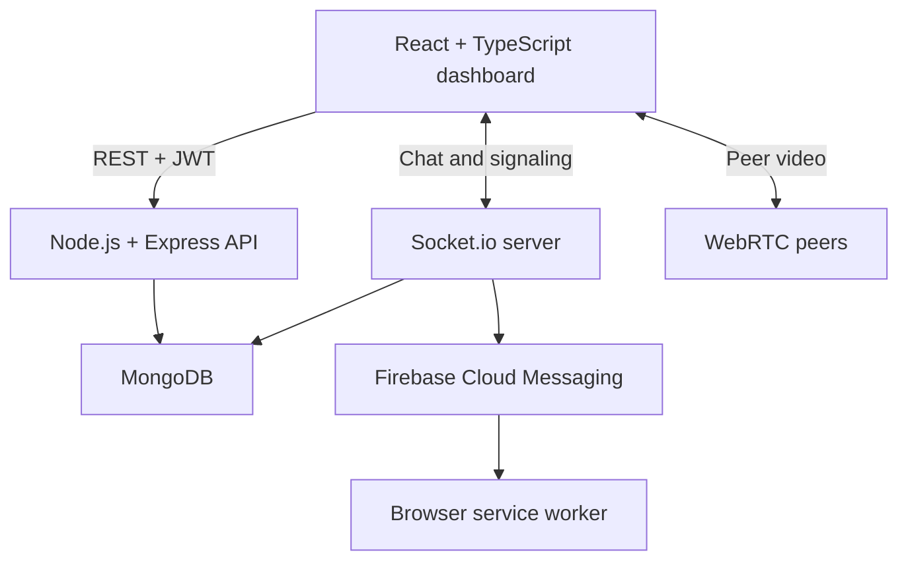

# CollabForge

**A full-stack study and collaboration workspace built with React, TypeScript, Node.js, Express and MongoDB.**

Manage tasks and notes, chat in campus rooms, join video sessions and track coding practice from one dashboard.

[Live Demo](https://ultimate-b-tech-buddy-6bha.vercel.app/) · [Source Code](https://github.com/Dhanvin1520/CollabForge) · [Firebase Setup](docs/firebase-notifications.md)

> The existing deployment URLs retain their original hosting names. The application and repository brand is **CollabForge**.

## Features

| Area | Implementation |
| --- | --- |
| Dashboard | Responsive React and TypeScript interface with navigation for study tools |
| Authentication | JWT login, password hashing and protected backend routes; guest mode for exploring the app |
| Tasks and notes | Express REST endpoints and user-scoped MongoDB records |
| Community chat | Socket.io messaging in NST Commons and NST Placements, with stored message history |
| Video rooms | WebRTC calling with Socket.io signaling and configurable STUN/TURN servers |
| Coding practice | LeetCode tracking and activity visualization |
| Study utilities | Calendar, focus timer, music interface, games and resume interface |
| AI assistant | Gemini-backed chat interface; requires provider configuration |
| Browser alerts | Optional Firebase Cloud Messaging notifications for signed-in users; requires Firebase configuration |

## Architecture



Firebase is optional. MongoDB remains the data store and JWT remains the authentication mechanism. Push notifications use generic text rather than exposing message contents.

## Technology

| Layer | Tools |
| --- | --- |
| Frontend | React, TypeScript, Vite, Tailwind CSS, Axios |
| Backend | Node.js, Express, Mongoose, JWT, bcrypt |
| Real-time | Socket.io, WebRTC |
| Notifications | Firebase Web SDK, Firebase Admin SDK, service worker |
| UI and graphics | Lucide, Three.js, React Three Fiber, GSAP |
| Deployment | Docker configuration, Vercel frontend, Render backend |

## Run locally

Use Node.js 22 or later for the current Firebase dependencies, npm and a MongoDB database. If your Node version manager follows the legacy `.nvmrc`, select Node.js 22 explicitly before installing.

```bash
git clone https://github.com/Dhanvin1520/CollabForge.git
cd CollabForge
npm install
cd backend
npm install
cd ..
```

Create a root `.env`:

```dotenv
VITE_API_URL=http://localhost:5000/api
VITE_SOCKET_URL=http://localhost:5000
# Optional: enables the AI assistant
VITE_GEMINI_API_KEY=your-development-key
```

Create `backend/.env`:

```dotenv
PORT=5000
MONGODB_URI=mongodb://127.0.0.1:27017/collabforge
JWT_SECRET=replace-with-a-long-random-secret
FRONTEND_URL=http://localhost:5173
```

Start the backend in one terminal:

```bash
cd backend
npm run dev
```

Start the frontend in a second terminal, from the repository root:

```bash
npm run dev
```

Open the URL printed by Vite. Backend health is available at `http://localhost:5000/api/health`.

`VITE_` variables are bundled into the browser. The existing Gemini integration calls the provider from the browser; use a restricted development key and move provider calls behind your backend before exposing a private production credential. Firebase Admin private keys belong only on the backend.

## Firebase notifications

Follow [Firebase setup and verification](docs/firebase-notifications.md) for frontend configuration, the public VAPID key and backend Admin credentials.

- Signed-in users opt into alerts for one public chat room per browser.
- Persisted messages from authenticated users can trigger background alerts; the sender is excluded.
- Users can disable alerts. Signing out also removes/revokes the browser subscription.
- Invalid registrations are cleaned up; inactive server records expire after 30 days.
- Without Firebase settings, chat still works and notification controls remain hidden.

**Status:** integration code and automated tests are included. Live delivery requires deployment configuration and the two-user verification steps in the setup guide; it is not claimed as verified here.

## Build and checks

From the repository root:

```bash
npm run build
npm run type-check
node --test backend/tests/notifications.test.js
```

The notification tests check validation, permanent-token error handling, disabled configuration, JWT enforcement and ownership-scoped writes using mocked database operations. They do not replace a live Firebase delivery test.

## Repository layout

| Path | Purpose |
| --- | --- |
| `src/components/Features/` | Chat, video, tasks, notes and study-tool interfaces |
| `src/components/Layout/` | Dashboard and navigation |
| `src/lib/` | API client and Firebase notification client |
| `backend/routes/` | Authentication, study tools and notification endpoints |
| `backend/models/` | MongoDB schemas |
| `backend/services/push.js` | Firebase Admin notification delivery |
| `backend/server.js` | Express application and Socket.io handlers |
| `backend/tests/` | Notification regression tests |
| `public/firebase-messaging-sw.js` | Background notification worker |
| `docs/firebase-notifications.md` | Notification setup and manual verification |

## Deployment notes

- Configure frontend API/socket URLs in Vercel and backend MongoDB/JWT settings in Render.
- Run the backend from `backend/` with `node server.js`, or from the repository root with `node backend/server.js`.
- Set `FRONTEND_URL` and, when needed, comma-separated `CORS_EXTRA_ORIGINS` for the deployed frontend.
- Browser push requires HTTPS outside localhost. Video connectivity across networks may require your own TURN service.
- Existing hosting addresses and infrastructure identifiers are retained so the branding update does not disconnect deployments.

## Contributing

Open an issue describing the change or submit a focused pull request. Include the checks you ran and screenshots for interface changes. Never commit credentials or `.env` files.
